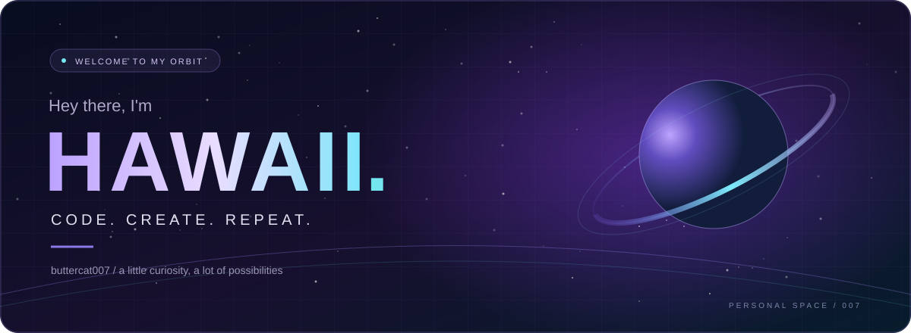

 

**Web technologies · Creative experiments · Endless curiosity**

  

### From the first pixel to the final deploy.

FRONTEND &amp; INTERFACE

  
LANGUAGES

  
BACKEND &amp; INFRASTRUCTURE

  
EVERYDAY COMPANIONS

  

---

### Small commits. Bigger possibilities.

  

---

### Somewhere between coding and the next idea.

  

**Thanks for stopping by my little corner of the universe.**

Stay curious. Keep creating. ✦

